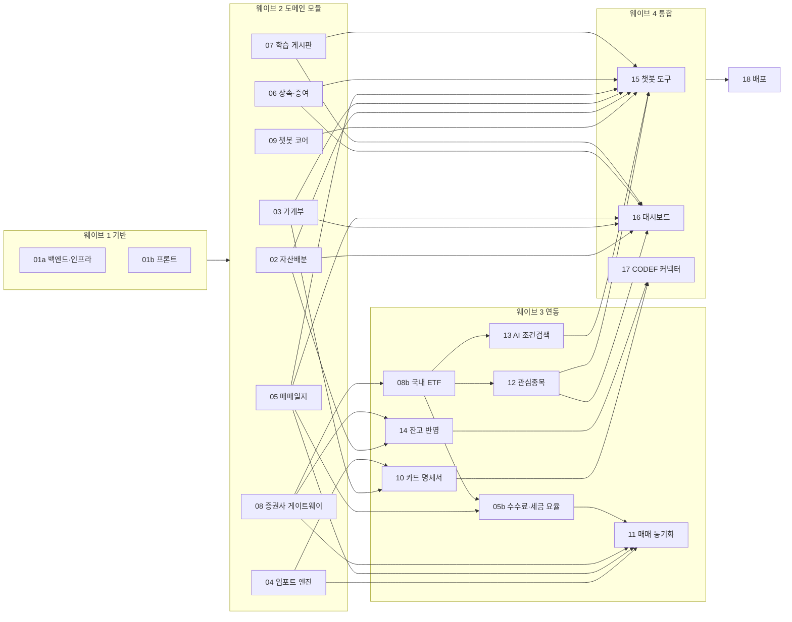

# 로드맵: 웨이브, 브랜치·워크트리, 구현 → 검증 → 병합 절차

> 코디네이터(사용자 또는 사용자가 지시한 에이전트)가 Orca 오케스트레이션으로 워커를 띄울 때 따르는 문서다.
> 상위 결정은 `docs/specs/00-master-plan.md`, 워커 공통 규칙은 `AGENTS.md`, 작업별 계약은 `docs/specs/NN-*.md`.

## 1. 웨이브와 의존 관계



- 기본은 웨이브 단위로 진행한다. 앞 웨이브의 PR이 모두 병합되고 **웨이브 통합 검증**을 통과한 뒤 다음 웨이브를 시작한다.
- 예외: 어떤 작업의 선행 작업이 모두 병합됐고 그 선행 작업들이 포함된 통합 검증을 통과했다면 웨이브를 기다리지 않고 시작해도 된다.
- 2웨이브는 워커 8명이다. 기기 자원(CPU·디스크, 워크트리마다 `node_modules`·`.venv`)이 부족하면 `02·03·04·05`와 `06·07·08·09` 두 묶음으로 나눠 띄운다.

## 2. 작업 표

| 작업 | 브랜치 | 스펙 | 구현 에이전트 | 선행 |
| --- | --- | --- | --- | --- |
| 01a | `feature/01-foundation-backend` | `01-foundation.md`(01a) | codex | |
| 01b | `feature/01-foundation-frontend` | `01-foundation.md`(01b) | claude | |
| 02 | `feature/02-allocation` | `02-allocation.md` | claude | 01 |
| 03 | `feature/03-ledger` | `03-ledger.md` | claude | 01 |
| 04 | `feature/04-imports` | `04-imports.md` | codex | 01 |
| 05 | `feature/05-journal` | `05-journal.md` | codex | 01 |
| 05b | `feature/05-journal-costs`(05 워크트리·슬롯 05 재사용) | `05b-journal-costs.md` | codex | 05, 08b |
| 06 | `feature/06-estate` | `06-estate.md` | codex | 01 |
| 07 | `feature/07-learn` | `07-learn.md` | claude | 01 |
| 08 | `feature/08-market` | `08-market.md` | codex | 01 |
| 08b | `feature/08-market-etf`(08 워크트리·슬롯 08 재사용) | `08b-market-etf.md` | codex | 08 |
| 09 | `feature/09-chat-core` | `09-chat-core.md` | claude | 01 |
| 10 | `feature/10-ledger-import` | `10-ledger-import.md` | codex | 03, 04 |
| 11 | `feature/11-journal-sync` | `11-journal-sync.md` | codex | 04, 05, 05b, 08, 08b |
| 12 | `feature/12-watchlist` | `12-watchlist.md` | claude | 08, 08b |
| 13 | `feature/13-screener` | `13-screener.md` | codex | 08, 08b |
| 14 | `feature/14-holdings-sync` | `14-holdings-sync.md` | codex | 02, 08 |
| 15 | `feature/15-chat-tools` | `15-chat-tools.md` | claude | 09, 02, 03, 05, 06, 07, 12, 13 |
| 16 | `feature/16-dashboard` | `16-dashboard.md` | claude | 02, 03, 05, 06, 07, 12 |
| 17 | `feature/17-connectors` | `17-connectors.md` | codex | 10, 14 |
| 18 | `feature/18-deploy` | `18-deploy.md` | codex | 전체, 호스팅 결정 |

- 구현 워커는 모델을 지정하지 않는다(사용자 기본값). **검증은 모든 작업이 codex `gpt-6.1-sol` / effort `xhigh`**다.
- 슬롯(포트·DB)은 브랜치 번호다(architecture 2.2). 01a·01b는 같은 `01`이지만 01b는 백엔드를 띄우지 않으므로 충돌하지 않는다(01b의 프론트 포트는 3001, 01a의 백엔드 포트는 8001).

## 3. 저장소·브랜치 준비 상태 (2026-10-16)

- 원격: GitHub 비공개 저장소 `ohch9712/finance-project`(`origin`).
- `main`: 설계 문서 커밋. `develop`: `main`에서 분기, 기본 체크아웃(코디네이터 작업 위치).
- 1웨이브 워크트리 2개를 Orca로 만들어 두었다(기준 `develop`, 브랜치 이름을 규칙대로 바꾸고 원격에 올림).
  - `feature/01-foundation-backend` → `/Users/ochunghwan/orca/workspaces/금융 프로젝트/feature-01-foundation-backend`
  - `feature/01-foundation-frontend` → `/Users/ochunghwan/orca/workspaces/금융 프로젝트/feature-01-foundation-frontend`
- 원격 주소는 HTTPS이고, 저장소 로컬 설정에 gh 자격 증명 도우미(`credential.https://github.com.helper = !gh auth git-credential`)를 넣었다. 이 기기의 SSH 키는 암호가 걸려 있어 에이전트 셸에서 푸시할 수 없었기 때문이다. 워커는 `gh auth status`가 로그인 상태이면 그냥 `git push`하면 된다. SSH로 되돌리려면 `git remote set-url origin git@github.com:ohch9712/finance-project.git`.
- 2웨이브 이후 브랜치는 디스패치할 때 그 시점의 `develop`에서 만든다.
- Orca 저장소 id: `5c07c49e-6263-4f45-bf2b-d995226a1433`. 기본 기준 브랜치는 `develop`.

## 4. 웨이브 진행 절차 (코디네이터)

### 4.1 시작 전

1. `git -C <기본 체크아웃> switch develop && git pull --ff-only`
2. 3웨이브 이후: 스펙 머리말의 "착수 직전 갱신" 지시대로 실제 코드와 대조해 스펙을 고치고 `develop`에 커밋·푸시한다.
3. Run을 만든다.

```text
orca orchestration run-create --objective "웨이브 N: <작업 목록>" --json
```

### 4.2 작업 만들기

구현 작업과 검증 작업을 함께 만든다. 검증 작업은 구현 작업에 의존한다. 명세 본문은 6절 블록을 쓴다.

```text
orca orchestration task-create --task-title "[NN] <제목> 구현" --spec "<6.1 블록>" --json
orca orchestration task-create --task-title "[NN] <제목> 검증" --spec "<6.2 블록>" --deps '["<NN 구현 task id>"]' --json
```

### 4.3 구현 디스패치

Orca는 `--name feature/NN-<slug>`로 워크트리를 만들면 브랜치를 `<git 사용자>/feature-NN-<slug>`(예: `ohch9712/feature-02-allocation`)로 만든다. 그래서 2웨이브부터는 **워크트리를 먼저 만들고 브랜치 이름을 규칙대로 바꾼 뒤** 디스패치한다(`worker-start --worktree new-top-level`은 쓰지 않는다. 워커의 setup이 이름 변경보다 먼저 돌 수 있다).

```bash
# 1) 워크트리 생성(기준 develop, setup은 워커가 직접 실행)
orca worktree create --repo id:5c07c49e-6263-4f45-bf2b-d995226a1433 --name feature/NN-<slug> --base-branch develop --no-parent --setup skip --json
# 2) 브랜치 이름 맞추기, Orca 정보 갱신, 원격 등록
W="/Users/ochunghwan/orca/workspaces/금융 프로젝트/feature-NN-<slug>"
git -C "$W" branch -m feature/NN-<slug>
orca worktree show --worktree "path:$W" --json > /dev/null
git -C "$W" push -u origin feature/NN-<slug>
```

```text
# 3) 디스패치(1웨이브 워크트리는 이미 1~2단계를 마쳤다)
orca orchestration worker-start --task <01a 구현 task id> --worktree branch:feature/01-foundation-backend --agent codex --json
orca orchestration worker-start --task <01b 구현 task id> --worktree branch:feature/01-foundation-frontend --agent claude --json
orca orchestration worker-start --task <NN 구현 task id> --worktree branch:feature/NN-<slug> --agent <codex|claude> --json
```

- 독립 작업은 기다리지 말고 한 번에 모두 띄운 뒤 대기한다.
- 기존 워크트리로 디스패치하면 Orca가 setup을 다시 돌리지 않는다. 워커가 첫 단계로 `scripts/worktree-setup.sh`를 실행한다(6.1 블록에 포함).

### 4.4 대기와 처리

```text
orca orchestration check --wait --types "worker_done,escalation,question" --timeout-ms 900000 --json
```

| 받은 것 | 처리 |
| --- | --- |
| `question` | 스펙·아키텍처로 답할 수 있으면 `reply`. 공유 파일·의존성 변경 요청이면 코디네이터가 `develop`에 반영·푸시한 뒤 워커에게 `git merge origin/develop`을 지시한다 |
| 구현 `worker_done --outcome succeeded` | PR URL 확인 → 같은 워크트리에 검증 디스패치(4.5) → 구현 워커는 수정 가능성이 있으므로 `worker-retain` |
| 구현 `failed` | 요약을 읽고 원인이 스펙이면 스펙을 고쳐 재시도(`--retry-of`), 환경이면 해결 후 재시도 |
| 검증 `succeeded` | PR 병합(4.6) → 구현·검증 워커 `worker-release` |
| 검증 `failed` | PR 코멘트의 발견 사항으로 수정 작업 디스패치(4.5) → 끝나면 같은 검증 작업을 `--retry-of`로 다시 |

`question`에 답하거나 `worker_done`을 처리한 뒤 `--ack <delivery_id>`로 확인하고 다시 기다린다. 기대한 모든 Dispatch가 정리될 때까지 반복한다.

### 4.5 검증·수정 디스패치

```text
# 검증
orca orchestration worker-start --task <NN 검증 task id> --worktree branch:feature/NN-<slug> \
  --agent codex --model gpt-6.1-sol --effort xhigh --json

# 수정(검증 실패 시). 유지해 둔 구현 터미널이 있으면 --terminal <handle>로 재사용한다
orca orchestration task-create --task-title "[NN] 검증 지적 수정" --spec "<6.3 블록>" --json   # 실패한 검증 작업에 --deps를 걸지 않는다
orca orchestration worker-start --task <수정 task id> --worktree branch:feature/NN-<slug> --agent <구현 에이전트> --json

# 재검증
orca orchestration worker-start --task <NN 검증 task id> --retry-of <실패한 검증 dispatch id> --worktree branch:feature/NN-<slug> \
  --agent codex --model gpt-6.1-sol --effort xhigh --json
```

- 수정 작업에는 `--deps`를 걸지 않는다. 실패로 끝난 작업에 의존하면 수정 작업이 시작되지 않는다. 같은 검증 작업은 연속 3번 실패하면 Orca가 닫으므로, 재검증 전에 코디네이터가 수정 내용을 직접 확인한다(웨이브 1에서는 로그인 `next` 우회를 입력 수만 건으로 확인했다).
- 구현 워커의 터미널은 검증이 끝날 때까지 `worker-retain`으로 남겨 수정에 `--terminal`로 다시 쓴다. 에이전트 상태가 오래돼 `stale_status`면 새 워커를 띄운다.

### 4.6 병합

```bash
gh pr merge <PR 번호> --merge          # --delete-branch는 쓰지 않는다(워크트리가 브랜치를 쓰고 있다)
git -C <기본 체크아웃> pull --ff-only
```

- 같은 웨이브 PR끼리 충돌이 나면(소유권 규칙상 드물다) 늦게 끝난 작업의 구현 워커에게 `git merge origin/develop` 후 충돌 해결·재검증을 맡긴다.

### 4.7 웨이브 통합 검증

웨이브의 PR이 모두 병합되면 기본 체크아웃(`develop`)에서 검증 워커를 띄운다.

```text
orca orchestration worker-start --spec "<6.4 블록>" --task-title "웨이브 N 통합 검증" --worktree current \
  --agent codex --model gpt-6.1-sol --effort xhigh --json
```

통합 검증이 실패하면 발견 사항을 해당 모듈 구현 에이전트에게 수정 작업으로 돌리고(그 모듈 브랜치를 `develop`에서 새로 만든다: `feature/NN-<slug>-fix-<번호>`), PR → 검증 → 병합 → 통합 검증을 반복한다.

### 4.8 릴리스와 정리

```bash
gh pr create --base main --head develop --title "[릴리스] 웨이브 N" --body "<웨이브 작업 목록, 통합 검증 결과>"
gh pr merge <PR 번호> --merge
```

- 웨이브가 끝나면 병합된 작업 워크트리를 정리한다(`orca worktree rm --help`로 선택자를 확인). 열린 워커는 `worker-list --run <run_id> --terminal-state reclaimable --json`이 빈 목록이 될 때까지 `worker-release`.

### 4.9 운영 메모 (웨이브 1에서 겪은 일)

- **codex 업데이트 안내**: codex가 새 버전 안내를 띄우면 `worker-start`가 `agent_readiness` 단계에서 `Agent startup blocked: agent-update-prompt`로 실패한다. 실패한 시도는 영수증대로 `worker-release`하고, Orca가 띄우는 codex의 버전 파일(`~/Library/Application Support/orca/codex-accounts/<계정 id>/home/version.json`. `~/.codex/version.json`이 아니다)의 `dismissed_version`을 `latest_version`과 같게 적거나(그 버전 건너뛰기) codex를 올린 뒤 `--retry-of`로 다시 띄운다. 디스패치 전에 `npm view @openai/codex version`으로 확인한다.
- **슬롯 포트 충돌**: 이 기기에서는 다른 프로젝트가 8000을 쓰고 있다. `scripts/start.sh`는 점유 프로세스를 죽이지 않고 멈춘다(정상). 슬롯 00 통합 검증은 백엔드 8090(`FRONTEND_ORIGIN=http://localhost:3090`)·프론트 3090(`NEXT_PUBLIC_API_BASE_URL=http://localhost:8090`)으로 직접 띄워 진행하고, 디스패치 전에 `lsof -nP -iTCP:<port> -sTCP:LISTEN`으로 확인한다.
- **localhost 쿠키 충돌**(웨이브 2): 쿠키는 포트를 구분하지 않아서 여러 워크트리 서버가 공용 Orca 브라우저 프로필에서 `finance_session`을 서로 덮어쓴다. 동시에 도는 워커의 화면 확인은 독립 브라우저 컨텍스트(Orca isolated 프로필, Playwright 새 context)에서 로그인한다. 디스패치 spec이나 메시지에 적어 준다.
- **공개 저장소와 비밀값**(2026-10-17): 저장소가 공개로 바뀌었다. PR 코멘트와 검증 보고서도 공개이므로 비밀값을 쓰지 않는다(AGENTS.md 보안 절). 실제 `GEMINI_API_KEY`는 기본 체크아웃 `backend/.env`에만 있다. 기본 체크아웃에서 도는 통합 검증은 서버를 `LLM_GENERAL_PROVIDER=disabled`·`LLM_PERSONAL_PROVIDER=disabled`로 띄우고 `.env` 내용을 출력하지 않는다고 spec에 적어 준다. GitHub secret scanning·push protection을 켰고, `.git/hooks/pre-commit`(추적하지 않음)이 `.env` 파일·Google 키 형태 문자열·`backend/.env`의 실제 비밀값 커밋을 막는다.
- **디스크 부족**(웨이브 2): 워크트리마다 `node_modules`·`.venv`가 약 1GB이고 build 산출물도 쌓여, 4개 동시 진행 중 여유 공간이 117MB까지 떨어지고 Docker Desktop(공용 Postgres)이 멈췄다. 디스패치 전에 `df -h /`로 여유 15GB 이상을 확인한다. Docker가 `unable to start`로 멈추면 앱을 종료한 뒤 다시 열거나 재부팅한다.
- **수정 브랜치**: 통합 검증에서 나온 결함은 그 모듈의 기존 워크트리에서 `git switch -c feature/NN-<slug>-fix-<번호> origin/develop`으로 브랜치를 만들고 `orca worktree show --worktree path:<경로>`로 Orca를 갱신한 뒤 디스패치한다(의존성·DB 슬롯을 다시 쓸 수 있다).

## 5. 웨이브별 통합 확인 항목 (6.4 블록이 참조)

| 웨이브 | 준비 명령 | 핵심 흐름 |
| --- | --- | --- |
| 1 | `scripts/worktree-setup.sh` | 가입 → 온보딩(출생연도) → 프로필 수정 → 로그아웃 → 재로그인. localhost 3000↔8000 쿠키 전달, 자리표시 화면 전부, 앱 셸·모바일 메뉴 |
| 2 | 위 + `uv run python -m app.modules.learn.seed`, `uv run python -m app.modules.market.jobs seed-mock` | 가입 → 온보딩 → 설문 → 목표·상황 → 자산 간단 입력 → 추천 결과 → 상세 설명 → 리포트·점수(스펙 02 5.8 사례 값, 건너뛰기 경로 포함) / 가계부 입력 → 요약 / 매매 입력 → 보유·통계 / 가족·증여 기록 → 공제 현황·세금 계산·방향 비교(스펙 06 사례 값, 02 병합 후 자산 사전 채움) / 학습 목록·상세 / 종목 검색 API / 챗봇(공급자 꺼짐이면 안내 상태, 로컬 Ollama나 결제 Gemini가 있으면 `get_my_profile`) / `/api/ai/status` / 개발용 Mock 증권사 연결 확인 |
| 3 | 위와 같음 | 가짜 카드 파일 업로드 → 리뷰 → 요약 반영 / 매매 파일 업로드, Mock 연결 체결 동기화, 평가손익 / 관심종목 담기 → 상세 차트 / 조건검색 칩 실행·`?f=` 링크 / 잔고 동기화 → 배분 점수 변화 |
| 4 | 위와 같음 | 챗봇 도구 16개(가짜 공급자 시나리오, 실제 공급자가 있으면 평가 세트) / 홈 대시보드 새 사용자·데이터 사용자 / CODEF 흐름(respx 또는 샌드박스) |

모든 웨이브 공통: 빈 DB에서 `alembic upgrade heads` → `downgrade base` → `upgrade heads`, 백엔드·프론트 전체 테스트·린트·빌드, 360px 화면 확인, 다른 사용자 데이터 격리.

## 6. 작업 명세 블록 (`--spec`에 넣는 본문)

Orca 작업 명세 계약(대상·변경·제약·소유·완료 기준)을 따른다. `NN`, `<slug>`, `<제목>`을 바꿔 쓴다.

### 6.1 구현 (공통)

```text
[NN 구현] <제목>
대상: docs/specs/NN-<slug>.md 전체(01은 01a 또는 01b 범위). 작업 위치는 이 워크트리(브랜치 feature/NN-<slug>).
변경: 스펙의 목표·범위·DB·API·화면·테스트를 구현한다. 시작 전에 AGENTS.md, docs/architecture.md, 스펙을 끝까지 읽고 scripts/worktree-setup.sh를 실행한다(01b는 frontend만 직접 준비).
제약: 스펙이 유일한 계약이다. 경로·필드·상태코드·에러 코드·테이블·revision ID·서비스 함수 시그니처를 그대로 따른다. 의존성을 추가하지 않는다. 외부 API·LLM을 테스트에서 호출하지 않는다. 주문 기능을 만들지 않는다. 모호하거나 공유 파일을 고쳐야 하면 ask로 묻고 기다린다.
소유: 스펙 "소유 파일" 절의 경로만 만들고 고친다.
완료: 스펙 "완료 기준"과 AGENTS.md "공통 완료 기준"을 모두 통과하고, 스펙 끝에 "## 구현 결과"를 추가하고, 커밋·푸시 후 gh pr create --base develop(제목 "[NN] <제목>", 본문은 AGENTS.md 형식)로 PR을 연다. worker_done 요약에 PR URL과 실행한 검사 명령 결과를 넣는다.
```

### 6.2 검증 (공통, codex gpt-6.1-sol / xhigh)

```text
[NN 검증] <제목>
대상: 브랜치 feature/NN-<slug>의 develop 대상 PR과 이 워크트리.
변경: 없음. 저장소의 추적 파일을 고치거나 커밋·푸시·병합하지 않는다. 임시 파일은 $TMPDIR에만 만든다.
제약: AGENTS.md "검증 워커 규칙"을 따른다. 실제 외부 API를 부르지 않는다(스펙이 수동 확인을 허용한 경우 제외).
소유: PR 코멘트만 쓴다.
완료: scripts/worktree-setup.sh 후 공통 완료 기준 명령 전부, 빈 DB(finance_NN_verify) 마이그레이션 순환, 서버를 띄운 API 계약 대조, 소유 경로·보안·격리·고지 점검, 스펙 "검증 체크리스트" 전 항목 판정을 마치고 보고서를 gh pr comment로 남긴다. 차단·중요 발견이 없으면 --outcome succeeded, 있으면 --outcome failed와 발견 사항 요약.
```

### 6.3 검증 지적 수정 (공통)

```text
[NN 수정] <제목>
대상: PR <URL>의 최신 검증 코멘트에 적힌 발견 사항.
변경: 차단·중요 발견 사항을 모두 고치고, 경미 사항은 고치거나 PR 코멘트로 이유를 남긴다.
제약: 6.1과 같다. 스펙과 발견 사항이 충돌하면 ask로 묻는다.
소유: 스펙 "소유 파일" 절의 경로만.
완료: 공통 완료 기준 재통과, 같은 PR에 커밋·푸시, 고친 항목 목록을 PR 코멘트로 남기고 worker_done.
```

### 6.4 웨이브 통합 검증 (codex gpt-6.1-sol / xhigh)

```text
[웨이브 N 통합 검증]
대상: develop 최신 커밋(기본 체크아웃).
변경: 없음. 추적 파일을 고치지 않는다. 임시 파일은 $TMPDIR에만.
제약: AGENTS.md "검증 워커 규칙".
소유: 결과 보고만. 보고서는 $TMPDIR에 쓰고 worker_done --report-path로 넘긴다.
완료: docs/roadmap.md 5절의 웨이브 N 준비 명령과 핵심 흐름, 공통 항목을 모두 실제로 실행해 판정한다. 실패 항목마다 재현 방법, 관련 모듈·작업 번호를 적는다. 모두 통과면 succeeded, 아니면 failed.
```

### 6.5 작업별 덧붙임

공통 블록 끝에 아래 줄을 더한다.

| 작업 | 덧붙임 |
| --- | --- |
| 01a | "01b와 병렬이다. frontend/를 만들지 않는다. 4.1 백엔드 의존성을 모두 설치한다." |
| 01b | "01a와 병렬이다. backend/·scripts/를 만들지 않는다. 백엔드 없이 MSW로 테스트한다. 4.1 프론트 의존성과 shadcn 컴포넌트를 모두 설치한다." |
| 02 | "추천 계산(스펙 5.8~5.10)은 recommendation.py 순수 함수로 두고 사례 값과 문장 틀을 테스트로 고정한다. 금액 문장은 01a의 app.core.format을 쓴다." |
| 06 | "02와 병렬이다. 스펙 9.3의 지연 import 처리를 지킨다. 4절 세법 값을 국가법령정보센터 원문으로 다시 확인한다. 방향 비교(8.1) 사례 값을 ±1,000원 안으로 고정한다." |
| 08 | "키움·토스 엔드포인트는 공식 문서·공식 저장소에서 확인한 것만 구현하고 근거를 구현 결과 표에 남긴다." |
| 09, 15 | "LLM SDK 사용법은 architecture 9.1·11절과 스펙 5절의 형태만 쓴다. 다르면 설치된 패키지 소스를 확인하고 ask로 묻는다. 개인 데이터는 personal 등급 공급자로만 보낸다." |
| 10, 11 | "카드사·증권사 파일 프리셋은 실제 샘플 픽스처가 있을 때만 만든다." |
| 18 | "사용자의 호스팅 결정을 먼저 확인한다(스펙 3절)." |

## 7. 코디네이터 규칙

- 코디네이터는 기능 코드를 직접 고치지 않는다. 고칠 것은 수정 작업으로 디스패치한다. 예외는 문서(스펙 갱신)와 워커 요청에 따른 의존성·공유 파일 변경이며, 이것은 `develop`에 직접 커밋한다.
- 공유 파일을 바꾸면 진행 중인 워커 모두에게 `orchestration send`로 알리고 `git merge origin/develop`을 지시한다.
- 시드·배치 명령(`learn.seed`, `market.jobs seed-mock`)은 통합 검증 전에 기본 체크아웃 DB(`finance_00`)에 실행한다.
- 실제 Gemini·증권사·CODEF 키는 사용자만 `.env`에 넣는다. 코디네이터와 워커는 키 값을 출력하거나 커밋하지 않는다. 로컬 Ollama 모델은 사용자가 `ollama pull <OLLAMA_MODEL>`로 받는다.
